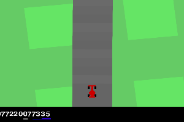
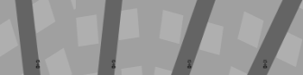
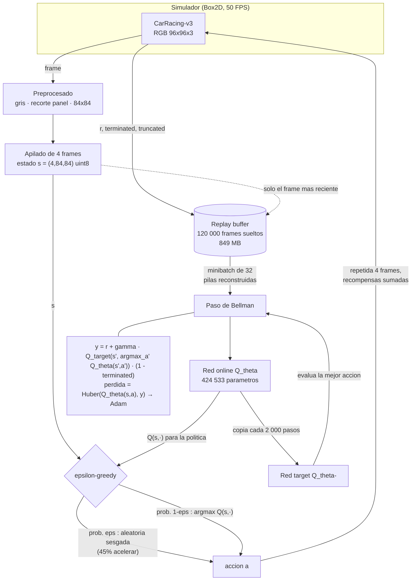
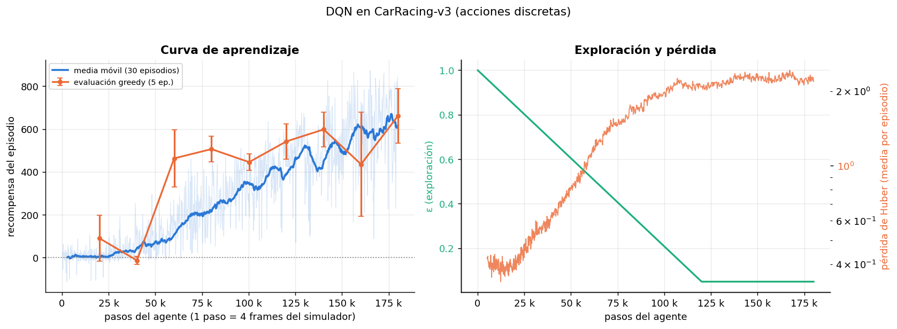
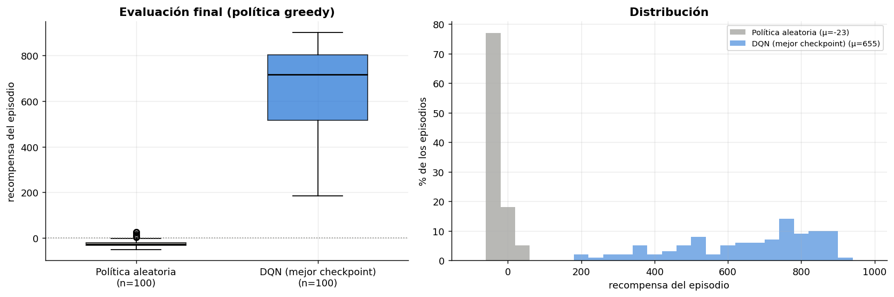

# DQN desde cero en CarRacing-v3

Agente **Deep Q-Network** implementado en PyTorch, sin frameworks de RL, para el entorno
[CarRacing-v3](https://gymnasium.farama.org/environments/box2d/car_racing/) de Gymnasium en su
variante de **acciones discretas**. Todo el ciclo —preprocesamiento de imagen, replay buffer,
red target, ε-greedy y paso de Bellman— está escrito en este repositorio.

**Grupo 8** · Maestría en Inteligencia Artificial, Universidad de La Sabana
*Simulación y Aprendizaje por Refuerzo*

| Agente | Recompensa media (100 episodios) | Mediana | Peor | Mejor |
|---|---|---|---|---|
| Política aleatoria | **−23.3 ± 16.6** | −28.5 | −51.2 | 26.1 |
| **DQN entrenado** | **654.9 ± 184.2** | 716.4 | 184.1 | 902.0 |

El agente completa el 78 % de los episodios con más de 500 puntos y nunca termina en negativo.
Entrenamiento: 180 000 pasos del agente (720 000 frames del simulador) en 145 minutos de CPU.



---

## 1. El ambiente

CarRacing-v3 es un simulador 2D de carreras construido sobre Box2D. En cada episodio se genera
una **pista nueva y aleatoria** y el agente conduce un carro visto desde arriba. No se había
trabajado en clase (vimos CartPole, MountainCar y LunarLander, todos con observaciones vectoriales);
aquí la observación es una **imagen**, que es lo que obliga a usar una CNN y a preprocesar.

### 1.1 Espacio de observaciones

| Propiedad | Valor |
|---|---|
| Tipo | `Box(0, 255, (96, 96, 3), uint8)` |
| Contenido | vista cenital en color del carro y la pista |
| Frecuencia | 50 FPS del simulador |
| Particularidad | los 12 píxeles inferiores son un **panel de indicadores** dibujado sobre la imagen (velocímetro, 4 barras de ABS, volante y giroscopio), no parte del mundo |

**Lo que recibe la red después del preprocesamiento:** `Box(0, 255, (4, 84, 84), uint8)`.

| Paso | De | A | Por qué |
|---|---|---|---|
| Escala de grises | 96×96×3 | 96×96 | El color no aporta: la pista es gris y el pasto verde uniforme. Reduce la entrada a un tercio. |
| Recorte del panel | 96×96 | 84×96 | El panel cambia en cada frame sin ser información espacial; mantenerlo obliga a la red a gastar filtros en leerlo. |
| Reescalado | 84×96 | 84×84 | Entrada cuadrada estándar de la arquitectura de Atari; `cv2.INTER_AREA` promedia al reducir y no genera aliasing. |
| **Apilado de 4 frames** | 84×84 | **4×84×84** | **Una sola imagen no contiene velocidad.** Con un frame fijo es imposible saber si el carro va a 10 o a 80 km/h, ni si está derrapando, y la política óptima depende de eso (frenar antes de la curva). Cuatro frames consecutivos convierten el problema en markoviano. |

La normalización a [0, 1] (dividir entre 255) ocurre **dentro de la red**, no en el buffer: así el
replay guarda `uint8` (1 byte por píxel) en vez de `float32` (4 bytes), un ahorro de 4× en memoria.



### 1.2 Espacio de acciones

`Discrete(5)` — se usa `continuous=False` al crear el entorno:

| Valor | Acción | Efecto en el simulador |
|:---:|---|---|
| 0 | no hacer nada | el carro sigue por inercia |
| 1 | girar a la derecha | `steer(−0.6)` |
| 2 | girar a la izquierda | `steer(+0.6)` |
| 3 | acelerar | `gas(0.2)` |
| 4 | frenar | `brake(0.8)` |

Se eligió la variante discreta porque DQN **no admite acciones continuas**: su objetivo requiere
un `max` sobre todas las acciones en cada paso, y con la variante continua (`Box(3,)`: dirección,
acelerador, freno) eso sería un problema de optimización por cada transición. Para acciones
continuas habría que ir a DDPG, TD3 o SAC.

Una consecuencia de la discretización que sí se nota: **no se puede acelerar y girar a la vez**.
El agente lo compensa alternando acciones en pasos consecutivos, lo que se ve en el GIF como un
zigzag leve en las rectas.

### 1.3 Sistema de recompensas

| Evento | Recompensa |
|---|---|
| Cada frame transcurrido | **−0.1** |
| Cada loseta de pista visitada | **+1000/N**, con N = total de losetas (≈ 280-320 según la pista) |
| Salirse del área de juego | **−100** y fin del episodio |

El diseño premia **avanzar rápido**: quedarse quieto acumula −0.1 por frame indefinidamente y
recorrer la pista entera en 732 frames da 1000 − 73.2 = 926.8 puntos. Como cada loseta vale ~3.3
puntos y nuestro agente agrupa 4 frames por decisión, una decisión típica recibe entre −0.4
(no avanza) y +6 (cruza dos losetas).

**Recorte de recompensa a ±5** durante el entrenamiento: un episodio puede dar saltos de +10 al
cruzar varias losetas en un frame, y esos picos desestabilizan el objetivo de Bellman. Las
métricas que se reportan son siempre la recompensa **sin recortar** del entorno.

### 1.4 Condiciones de terminación

| Condición | Tipo | Señal |
|---|---|---|
| Visitar el 95 % de las losetas (vuelta completa) | `terminated` | el episodio se logró |
| Salirse del área de juego | `terminated` | −100 |
| 1000 frames (TimeLimit del registro) | `truncated` | se acabó el tiempo, no el problema |
| **Corte propio**: 50 decisiones seguidas con recompensa negativa | `truncated` | el carro está fuera de pista o detenido |

La distinción importa para el aprendizaje: **solo `terminated` corta el bootstrapping**
(`1 − done` en el objetivo). Si se trata un truncado por tiempo como terminal, se le enseña al
agente que el mundo se acaba a los 1000 frames y que por tanto el futuro no vale nada, lo que sesga
todos los valores hacia abajo. En el código, el buffer guarda `terminal=terminated` y
`final=terminated or truncated` por separado: el primero entra en la ecuación de Bellman, el
segundo solo marca dónde cortar las pilas de frames.

El corte propio por inactividad no es parte del entorno: es una decisión de diseño que ahorró
cerca de un tercio del tiempo de entrenamiento. Un carro parado en el pasto no genera información
nueva, y los 1000 frames completos se irían en recoger −0.1.

---

## 2. Flujo lógico del entrenamiento



Paso a paso, lo que ocurre en cada iteración del bucle (`train.py`):

1. **Observar.** El entorno entrega un frame; el wrapper lo convierte a gris 84×84 y lo apila con
   los tres anteriores → estado `s` de forma (4, 84, 84).
2. **Decidir (ε-greedy).** Con probabilidad ε se explora; si no, `argmax_a Q_θ(s, a)`.
   ε baja linealmente de 1.0 a 0.05 durante los primeros 120 000 pasos.
3. **Actuar (con repetición).** La acción se mantiene **4 frames del simulador** y las recompensas
   se suman. A 50 FPS, una acción suelta casi no mueve el carro; además esto divide por 4 el número
   de pasadas por la red, que en CPU es el cuello de botella.
4. **Guardar.** La transición entra al replay buffer: solo el frame más reciente, la acción, la
   recompensa recortada, y las dos banderas (`terminated` y fin de episodio).
5. **Aprender.** Cada paso se muestrea un minibatch de 32 transiciones y se aplica un paso de
   gradiente sobre el error de Bellman (detalle abajo).
6. **Sincronizar.** Cada 2 000 pasos de gradiente, los pesos de la red online se copian a la red
   target.
7. **Evaluar.** Cada 20 000 pasos se corren 5 episodios con política puramente greedy y se guarda
   un checkpoint si mejoró.

### 2.1 Los tres ingredientes de DQN, y por qué están

| Ingrediente | Qué hace aquí | Qué pasaría sin él |
|---|---|---|
| **Replay buffer** (120 000 frames) | Rompe la correlación entre pasos consecutivos y permite reusar cada transición en varios minibatches | El descenso de gradiente supone muestras i.i.d.; con frames consecutivos de una misma curva, la red se sobreajusta a lo último que vio |
| **Red target** (copia cada 2 000 actualizaciones) | Congela el objetivo del aprendizaje | El objetivo se mueve con cada actualización: el agente persigue un blanco que se desplaza con él |
| **ε-greedy** (1.0 → 0.05) | Explora al principio, explota al final | Sin exploración, la red se queda con la primera política mediocre que encuentre |

El objetivo que se minimiza, con **Double DQN** (la red online elige la acción, la target la evalúa):

```
y = r + γ · Q_target(s', argmax_a' Q_online(s', a')) · (1 − terminated)
L = Huber(Q_online(s, a), y)
```

Se usa Double DQN porque el `max` del DQN clásico sobrestima sistemáticamente los valores
(E[max] ≥ max[E], desigualdad de Jensen), y aquí ese sesgo es especialmente dañino: con 5 acciones
cuyos valores son casi idénticos en la mayoría de los estados (ver §5), el `max` escoge casi siempre
el error de estimación más optimista. Cuesta dos líneas de código y ninguna red adicional.

### 2.2 Particularidades de este ambiente (y cómo se atacaron)

Esta es la sección que más decisiones de diseño explica. Nada de esto hizo falta en CartPole o
LunarLander.

| Particularidad | Síntoma | Solución aplicada |
|---|---|---|
| **La observación es una imagen sin velocidad** | Un frame no distingue entre ir rápido y estar quieto | Apilado de 4 frames |
| **El panel inferior está dibujado sobre la imagen** | Píxeles que cambian sin significado espacial | Recorte de las 12 filas inferiores |
| **Animación de zoom al inicio** | Los primeros ~50 frames la cámara se acerca: no son estados de decisión | Se consumen en `reset()` antes de empezar |
| **La exploración uniforme no produce datos útiles** | Con 5 acciones equiprobables, el carro casi nunca avanza: en el primer intento, 40 000 pasos de entrenamiento dieron una política greedy que se quedaba quieta (−40 de recompensa, exactamente el costo de estar parado) | **Exploración sesgada**: durante los pasos aleatorios, acelerar sale el 45 % de las veces y frenar el 5 %. Con el mismo presupuesto, la evaluación a 20 000 pasos pasó de −40 a +90 |
| **Pista nueva en cada episodio** | El agente no puede memorizar un circuito; tiene que generalizar | Es una ventaja: evaluamos sobre 100 semillas fijas, todas pistas distintas |
| **Costo de simulación alto** | El renderizado domina: ~160 frames/s en CPU, independientemente de la red | Repetición de acción (4), red más pequeña, corte por inactividad |
| **Memoria del replay** | Guardar (s, s') apilados costaría 56 KB por transición → 6.7 GB | El buffer guarda **frames sueltos** y reconstruye las pilas al muestrear: 7 KB por transición, 849 MB en total |

---

## 3. La red neuronal

```
Entrada: (lote, 4, 84, 84) uint8 → float / 255

  capa                 kernel / stride    salida            parámetros
  ---------------------------------------------------------------------
  Conv2d(4 → 16)       8×8 / 4            16 × 20 × 20        4 112
  ReLU
  Conv2d(16 → 32)      4×4 / 2            32 ×  9 ×  9        8 224
  ReLU
  Conv2d(32 → 32)      3×3 / 1            32 ×  7 ×  7        9 248
  ReLU
  Flatten                                 1 568
  Linear(1568 → 256)                      256               401 664
  ReLU
  Linear(256 → 5)                         5                   1 285
  ---------------------------------------------------------------------
  Total                                                     424 533
```

**Por qué esta arquitectura:**

- **Es la de Mnih et al. (2015) con la mitad de filtros y 256 unidades densas en vez de 512.**
  La red original (32-64-64 filtros, 512 densas) tiene ~1.7 M parámetros, cuatro veces los de esta, y
  todo el entrenamiento corrió en CPU con 2 núcleos compartidos con el simulador. CarRacing es
  visualmente mucho más simple que un juego de Atari —pista gris, pasto verde, un carro rojo, sin
  enemigos ni marcador— así que se recortó la capacidad para gastar el presupuesto en pasos de
  entorno, que era el recurso escaso.
- **Kernels grandes con stride grande al principio** (8×8 / 4): la primera capa busca estructuras
  amplias —el borde de la pista, la dirección de la curva— no texturas finas. El stride 4 reduce de
  84 a 20 y es lo que hace la red barata.
- **Kernels progresivamente más pequeños** (4×4/2, luego 3×3/1): capas más profundas sobre un mapa
  ya reducido, donde interesan relaciones locales entre bordes.
- **Sin pooling.** En control visual, *dónde* está la pista importa; el max-pooling introduce
  invariancia a la traslación, que es justo lo que no queremos.
- **Sin activación en la salida.** Los valores Q no están acotados (aquí llegan a ~113).
- **Una salida por acción** en vez de una red que reciba (s, a): un solo forward da los 5 valores,
  que es lo que necesita tanto el `argmax` de la política como el `max` del objetivo.

### Hiperparámetros

| Hiperparámetro | Valor | Razón |
|---|---|---|
| Optimizador | Adam, lr = 1e-4 | El valor habitual en implementaciones de DQN con entradas visuales; con una red target que se copia cada 2 000 pasos, tasas mayores mueven el objetivo más rápido de lo que la red alcanza a seguirlo |
| Pérdida | Huber (`SmoothL1`) | Cuadrática cerca de cero, lineal lejos: un objetivo atípico no produce un gradiente gigante |
| γ (descuento) | 0.99 | Con repetición de acción, 0.99 son ~100 decisiones de horizonte ≈ 8 segundos de carrera |
| Tamaño de minibatch | 32 | El del paper original; duplicarlo duplica el costo del paso de gradiente, que aquí compite por los mismos 2 núcleos que el simulador |
| Capacidad del buffer | 120 000 frames | ~2/3 del entrenamiento completo; más no cabía en memoria |
| Calentamiento | 5 000 pasos | Llenar el buffer antes del primer gradiente evita sobreajustar a las primeras transiciones |
| Frecuencia de entrenamiento | 1 paso de gradiente por paso del agente | Con 4 frames por paso, equivale a 1 actualización cada 4 frames, como en Atari |
| Actualización de la red target | cada 2 000 pasos de gradiente | Más corto desestabiliza; más largo retrasa la propagación de valor |
| ε | 1.0 → 0.05 en 120 000 pasos | Dos tercios del entrenamiento explorando; el 5 % final evita quedarse atascado |
| Sesgo de exploración | 45 % acelerar, 5 % frenar | Ver §2.2: sin esto el agente aprende a no moverse |
| Recorte de gradiente | norma ≤ 10 | Red de seguridad contra picos de pérdida |

---

## 4. Resultados

### 4.1 Curva de aprendizaje



Izquierda: recompensa por episodio durante el entrenamiento (azul claro: episodios sueltos; azul
oscuro: media móvil de 30) y evaluaciones periódicas con política greedy (naranja, 5 episodios,
barras de ±1 desviación). Derecha: ε y pérdida de Huber.

| Tramo (pasos del agente) | Recompensa media de entrenamiento | Largo medio del episodio | ε al final |
|---|---|---|---|
| 0 – 20 k | 4.9 | 101 | 0.84 |
| 20 k – 60 k | 45.6 | 140 | 0.53 |
| 60 k – 120 k | 291.8 | 224 | 0.05 |
| 120 k – 180 k | **541.4** | 231 | 0.05 |

El primer episodio por encima de 500 puntos aparece a los 95 867 pasos. La media de los últimos
100 episodios de entrenamiento es **600.0**, con ε = 0.05 (es decir, 1 de cada 20 acciones todavía
es aleatoria).

Evaluaciones periódicas (política greedy, 5 episodios cada una):

| Pasos | 20 k | 40 k | 60 k | 80 k | 100 k | 120 k | 140 k | 160 k | 180 k |
|---|---|---|---|---|---|---|---|---|---|
| Media | 90.4 | −13.0 | 463.3 | 506.7 | 445.9 | 542.5 | 598.3 | 435.9 | **661.8** |
| ±σ | 107.3 | 19.2 | 132.7 | 59.0 | 37.9 | 82.5 | 80.1 | 242.8 | 128.2 |

### 4.2 Evaluación final

100 episodios con política **puramente greedy**, sobre las **mismas 100 semillas** (pistas) para
ambos agentes:



| Métrica | Política aleatoria | DQN entrenado |
|---|---|---|
| Recompensa media | −23.3 ± 16.6 | **654.9 ± 184.2** |
| Mediana | −28.5 | 716.4 |
| Peor episodio | −51.2 | 184.1 |
| Mejor episodio | 26.1 | 902.0 |
| Episodios ≥ 500 | 0 % | **78 %** |
| Episodios ≥ 700 | 0 % | **51 %** |
| Episodios con recompensa negativa | 100 % | **0 %** |

El agente mejora al azar en **678 puntos**. El umbral informal de "resuelto" para CarRacing es 900
de media sobre 100 episodios: con 655 este agente **no resuelve el entorno**, pero conduce de forma
competente —nunca se queda quieto, nunca termina en negativo— con un presupuesto de cómputo dos
órdenes de magnitud menor que el de las implementaciones que llegan a 900.

### 4.3 Qué aprendió, en números

Distribución de las acciones de la política greedy (5 episodios, 1 190 decisiones) y valor Q medio
que la red asigna a cada una:

| Acción | Frecuencia de uso | Q medio |
|---|---|---|
| acelerar | **46.8 %** | 112.70 |
| izquierda | 20.5 % | 110.46 |
| nada | 18.8 % | 112.37 |
| derecha | 13.5 % | 110.45 |
| frenar | **0.4 %** | 106.24 |

El agente aprendió que acelerar es casi siempre la mejor acción y que frenar casi nunca lo es
(coherente: el costo de −0.1 por frame castiga ir despacio, y el freno de 0.8 es brusco). Usa "nada"
como freno motor suave en las curvas.

### 4.4 Segunda corrida independiente

Todo el entrenamiento se repitió desde cero en otra máquina (Windows, 241 minutos en vez de 145),
con **la misma configuración y la misma semilla**. Los artefactos de esa corrida están en
`results/corrida_2/`; la carpeta `results/` contiene la corrida que documenta este README.

| | Corrida 1 | Corrida 2 |
|---|---|---|
| Pasos / episodios | 180 000 / 1 010 | 180 128 / 1 015 |
| Evaluación final (100 ep.) | **654.9 ± 184.2** | **558.2 ± 174.4** |
| Mediana | 716.4 | 595.3 |
| Peor / mejor episodio | 184.1 / 902.0 | 154.4 / 863.0 |
| Episodios ≥ 500 | 78 % | 64 % |
| Episodios negativos | 0 % | 0 % |

**Las conclusiones no cambian** —el agente conduce, nunca se estrella en evaluación, supera al azar
por casi 600 puntos— pero la diferencia de 97 puntos entre corridas es estadísticamente clara
(Mann-Whitney, p = 0.0001). Dos lecturas:

- **Misma semilla no garantiza mismo resultado.** Basta una diferencia de redondeo en una
  multiplicación de matrices —distinto hardware, distinta versión de BLAS, distinto número de hilos—
  para que dos trayectorias diverjan. En aprendizaje por refuerzo esa divergencia se amplifica: una
  acción distinta cambia el estado siguiente, que cambia lo que entra al replay buffer, que cambia
  todo lo que viene después.
- **Reportar una sola corrida sobreestima lo que sabes.** Con n = 2 no se puede dar un intervalo de
  confianza serio, pero el rango 558-655 es una cota inferior honesta de la variabilidad entre
  corridas. La práctica recomendada en la literatura es 3-5 semillas y reportar media ± desviación
  entre ellas; aquí no alcanzó el presupuesto de cómputo (cada corrida son 2.5-4 horas de CPU).

---

## 5. Reflexión sobre los resultados

**Lo que funcionó.** El salto de −23 a 655 muestra que el ciclo DQN está bien implementado y que el
preprocesamiento captura lo que el problema necesita. La forma de la curva es la típica de DQN con
observaciones visuales: una meseta larga mientras el buffer se llena de experiencias mediocres
(0–40 k), un despegue abrupto cuando la red empieza a asociar "pista al frente → acelerar"
(40–60 k), y una mejora lenta y ruidosa después.

**La limitación estructural más clara es la discretización de las acciones.** El carro real necesita
girar *mientras* acelera, y con 5 acciones mutuamente excluyentes eso solo se puede aproximar
alternando acciones en pasos consecutivos. Se ve en el GIF: en las rectas el agente zigzaguea
levemente porque corrige la dirección a costa de soltar el acelerador. Ese costo tiene un techo que
ninguna cantidad de entrenamiento adicional elimina; para superarlo habría que ir a un algoritmo de
acciones continuas (SAC, TD3) o ampliar el conjunto discreto con combinaciones
(acelerar+izquierda, acelerar+derecha…), que es lo que hacen las implementaciones que llegan a 900.

**La segunda limitación es el presupuesto.** 720 000 frames es poco: las referencias que resuelven
CarRacing usan entre 1 y 5 millones. La curva de evaluación seguía subiendo al final (661 en el
último punto, el mejor de todos), así que el agente estaba lejos de su techo; se detuvo por tiempo
de cómputo, no por convergencia. Esto también explica la varianza alta (±184): en las pistas con
curvas cerradas encadenadas el agente todavía se sale, y en las abiertas saca más de 850.

**Un detalle que vale la pena señalar**: los valores Q de las cinco acciones están todos entre 106 y
113, es decir, separados por menos del 6 %. La red no aprende "esta acción es buena y esta es mala",
sino diferencias finas sobre un valor de estado dominante —exactamente la situación que motiva la
arquitectura *dueling*, que separa V(s) de A(s,a). Es la extensión natural de este trabajo.

**Sobre la evaluación.** Comparar contra una política aleatoria es el mínimo: dice que el agente
aprendió algo, no qué tan bien. Una comparación más informativa habría sido contra un controlador
heurístico escrito a mano (como hicimos en la actividad anterior con LunarLander), pero para
CarRacing eso exige extraer la geometría de la pista de los píxeles, que es un proyecto en sí mismo.

---

## 6. Reflexión sobre lo que más costó

**1. La exploración, de lejos.** Fue el problema conceptual más difícil y el que casi hunde el
proyecto. El primer entrenamiento llegó a 40 000 pasos con una política greedy que obtenía
exactamente −40 en todos los episodios de evaluación: el agente había aprendido a **quedarse
quieto**. Y era racional desde su punto de vista: con exploración uniforme sobre 5 acciones, acelerar
sale 1 de cada 5 veces y basta un frenazo aleatorio para detener el carro, así que el buffer estaba
lleno de episodios sin una sola loseta visitada. La red jamás había visto una recompensa positiva
grande, y entre "perder −0.4 por paso quieto" y "arriesgarse a salir de la pista" elegía lo primero.
La solución —sesgar la distribución de exploración hacia el acelerador— es trivial de escribir y
nada obvia de diagnosticar. La lección: **cuando un agente no aprende, el problema suele estar aguas
arriba del algoritmo, en los datos que la exploración genera**.

**2. El replay buffer con frames apilados.** Guardar (s, s') con pilas completas habría pedido 6.7 GB.
La alternativa —guardar frames sueltos y reconstruir las pilas al muestrear— es ocho veces más
barata, pero introduce dos errores silenciosos muy fáciles de cometer: mezclar frames de dos
episodios distintos en una misma pila, y cruzar la cabeza de escritura del buffer circular (donde el
frame "anterior" es en realidad el más nuevo). Ninguno de los dos hace fallar el programa: solo
degradan el aprendizaje sin dejar rastro. Por eso el repositorio incluye `tests/test_replay.py`, que
compara transición por transición contra una implementación ingenua que guarda las pilas completas.
La primera versión del código fallaba esa prueba.

**3. El cómputo, pero no como se esperaba.** El cuello de botella no fue la red (424 k parámetros son
nada) sino **el renderizado del simulador**: ~160 frames/s, y no hay forma de acelerarlo sin GPU ni
paralelización. Esto cambió decisiones de diseño: repetición de acción 4, red reducida a la mitad,
corte temprano de episodios improductivos. Medir primero (un benchmark de 400 pasos) y después
dimensionar el experimento ahorró horas de entrenamiento mal planeado.

**4. Terminado vs. truncado.** Es una distinción que ya habíamos visto, pero aquí convive con el
corte propio por inactividad, y hay que mantener *dos* banderas separadas: una para la ecuación de
Bellman (`terminated`) y otra para el buffer (fin de episodio, de cualquier tipo). Confundirlas le
enseña al agente que el mundo se acaba a los 1000 frames.

---

## 7. Reproducir

```bash
pip install -e .            # o: pip install -r requirements.txt

python -m dqn_carracing.train --pasos 180000        # ~145 min en 2 CPU
python -m dqn_carracing.evaluate --checkpoint checkpoints/mejor.pt --episodios 100
python -m dqn_carracing.evaluate --aleatorio --episodios 100       # baseline
python -m dqn_carracing.plots                                      # figuras
python -m dqn_carracing.record --checkpoint checkpoints/mejor.pt   # GIF
python tests/test_replay.py                                        # pruebas del buffer
```

Relanzar `train` cuando ya hay resultados escribe en `results/corrida_N/` en vez de mezclar las dos
corridas en el mismo CSV; para continuar una corrida interrumpida, `--reanudar`.

Opciones útiles: `--sin-doble` (DQN clásico en vez de Double DQN),
`--exploracion-uniforme` (reproduce el fallo descrito en §6.1), `--reanudar` (continúa desde el
último checkpoint).

### Estructura

```
src/dqn_carracing/
├── env.py        # preprocesamiento: gris, recorte, repetición de acción, apilado
├── model.py      # la CNN (424 533 parámetros)
├── replay.py     # replay buffer de frames sueltos
├── agent.py      # ε-greedy, paso de Bellman (Double DQN), persistencia
├── train.py      # bucle de entrenamiento, evaluación periódica, checkpoints
├── evaluate.py   # evaluación greedy y baseline aleatorio
├── plots.py      # curva de aprendizaje y comparación
└── record.py     # GIF del agente
tests/test_replay.py
results/          # CSV del entrenamiento, JSON de evaluación, figuras, GIF
results/corrida_2/  # segunda corrida independiente (ver §4.4)
checkpoints/      # mejor.pt (incluido en el repo, 6.8 MB)
```

Versiones usadas: Python 3.11, gymnasium 1.3.0, torch 2.14.0 (CPU), numpy 2.x, opencv 4.13.
Semilla 0 para el agente; las evaluaciones usan las semillas de entorno 10000-10099.

## Referencias

- Mnih, V., Kavukcuoglu, K., Silver, D., et al. (2015). Human-level control through deep reinforcement learning. *Nature, 518*(7540), 529-533.
- van Hasselt, H., Guez, A., & Silver, D. (2016). Deep reinforcement learning with Double Q-learning. *AAAI*. arXiv:1509.06461.
- Towers, M., et al. (2024). *Gymnasium: A standard interface for reinforcement learning environments*. arXiv:2407.17032. https://gymnasium.farama.org/environments/box2d/car_racing/
- Klimov, O. CarRacing-v3, implementación original en Gymnasium (Box2D).
